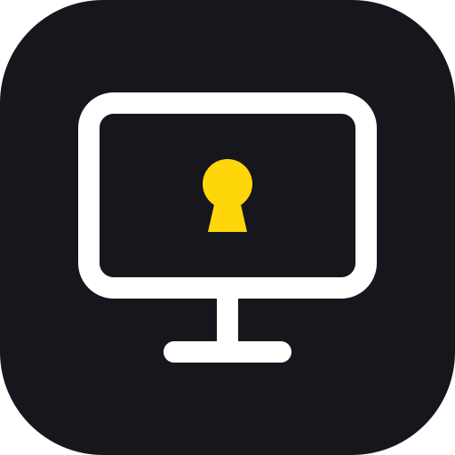

# ScreenISO

App per la barra dei menu di macOS. Serve quando un processo lungo (per esempio Claude Code) deve continuare a lavorare mentre l'utente è lontano dal Mac: dal pannello si scelgono le attività che tengono sveglio il Mac e si blocca lo schermo con il blocco nativo di macOS. Le due cose sono indipendenti: le attività restano attive finché non vengono spente, a schermo sbloccato come a schermo bloccato. Ogni cambio e ogni blocco vengono scritti in un registro di audit utilizzabile come evidenza per ISO 27001.

## Cosa fa e cosa non fa

Fa:

- tiene sveglio il Mac con le stesse assertion di `caffeinate` (`-d`, `-i`, `-s`, `-m`, `-u`), attivabili una per una e subito;
- attiva e disattiva `pmset disablesleep`, che tiene sveglio il Mac anche a coperchio chiuso;
- blocca lo schermo con la schermata di blocco di macOS, oppure avviando il salvaschermo;
- verifica che il blocco sia avvenuto davvero, altrimenti lo segnala;
- scrive un registro append-only in formato JSON Lines.

Non fa:

- non mostra una schermata di blocco propria: password e Touch ID sono gestiti da macOS (loginwindow);
- non cambia l'impostazione che fa chiedere la password subito dopo il blocco: la controlla e apre il pannello delle Impostazioni di Sistema dove si cambia;
- non spegne le attività da sola: né allo sblocco, né a tempo;
- non sorveglia il processo che sta lavorando;
- non installa aggiornamenti da sola: li segnala nel pannello e li installa quando lo chiedi;
- non si avvia al login.

## Requisiti

- macOS 14 o successivo (sviluppata e provata su macOS 26.6, Apple silicon).
- Per compilare: Command Line Tools con Swift 6. Xcode non serve.
- Per `SleepDisabled`: un account amministratore per installare la regola sudoers.

## Build

```sh
make build
```

Produce `build/ScreenISO.app`, che contiene:

- `Contents/MacOS/ScreenISO`, compilato in release (solo arm64: senza Xcode SwiftPM non produce binari universali);
- `Contents/Info.plist` con bundle id `it.yellowtech.screeniso`, versione 0.1.3, `LSUIElement` attivo (nessuna icona nel Dock);
- `Contents/Resources/AppIcon.icns`, l'icona dell'app;
- `Contents/Resources/ScreenISOSaver.saver`, compilato da `Saver/build.sh`.

Lo script `scripts/bundle.sh` si ferma al primo passo che fallisce. La firma è ad-hoc: prima il salvaschermo annidato, poi l'app, infine `codesign --verify --deep --strict`.

Gli altri comandi:

```sh
make lint     # swift format lint --strict
make format   # swift format --in-place
make test     # swift test (Swift Testing)
make icon     # rigenera Resources/AppIcon.icns da assets/logo.svg
```

L'icona è nel repository già generata: `make icon` serve solo quando cambia il logo.

Per leggere lo stato del sistema senza aprire l'interfaccia:

```sh
build/ScreenISO.app/Contents/MacOS/ScreenISO --status
```

Stampa un JSON con la politica di blocco, lo stato di `SleepDisabled`, la regola sudoers, la disponibilità della funzione di blocco e di Touch ID, se il salvaschermo è installato e se risulta selezionato. È in sola lettura.

## Installazione

### Con Homebrew

```sh
brew install --cask mbilo126/screeniso/screeniso
```

Installa `ScreenISO.app` in `/Applications` da una release di questo repository. Il nome completo aggiunge il tap `mbilo126/screeniso` e autorizza solo questo cask. Serve un Mac Apple silicon con macOS 14 o successivo. È l'unico comando da eseguire nel Terminale: l'app si apre da Spotlight o dalla cartella Applicazioni e il resto si fa dal pannello. Per aggiornare:

```sh
brew update && brew upgrade --cask screeniso
```

La copia installata con Homebrew controlla da sola se c'è una versione nuova: all'avvio e poi una volta al giorno legge la versione scritta nel cask del tap. È una richiesta HTTPS a `raw.githubusercontent.com` che non invia dati dell'utente e non lascia cookie né cache. Quando la versione nel tap è più recente, il pannello mostra il pulsante "Aggiorna alla <versione>", che esegue `brew upgrade --cask mbilo126/screeniso/screeniso` e riavvia ScreenISO. Niente viene installato senza quel clic: il riavvio spegne le opzioni di `caffeinate` attive, che vanno riattivate; `SleepDisabled` resta com'è.

Prima di disinstallare, togli la regola sudoers dal pannello ("Rimuovi regola sudoers"): `brew uninstall` non la rimuove.

### Dal sorgente

Dopo `make build`, copia `build/ScreenISO.app` in `/Applications`. Un'app compilata in locale non ha l'attributo di quarantena, quindi Gatekeeper non la blocca. Se copi a mano l'app compilata su un altro Mac, macOS la blocca al primo avvio: va autorizzata da Impostazioni di Sistema, Privacy e sicurezza, "Apri comunque". Una copia compilata dal sorgente non controlla gli aggiornamenti: si aggiorna con `git pull` e `make build`.

### Dopo l'installazione

Aprendo l'app compare una finestra con il pannello e l'icona `lock.shield` nella barra dei menu, da cui si riapre lo stesso pannello. L'icona è piena finché almeno un'attività tiene sveglio il Mac. L'app non ha icona nel Dock: chiudere la finestra non la termina, e aprirla di nuovo dal Finder o da Spotlight rimostra la finestra.

Quando la barra dei menu è piena macOS non disegna le icone che non ci stanno, a partire dalle ultime arrivate: su un Mac con il notch l'icona di ScreenISO può restare nascosta. In quel caso il pannello mostra il pulsante "Mostra icona nella barra dei menu", che riavvia ScreenISO e mette l'icona accanto a quelle di sistema. Il riavvio spegne le opzioni di `caffeinate` attive, che vanno riattivate; `SleepDisabled` resta com'è.

## Primo avvio

Il pannello ha due sezioni, Attività e Blocco. Quello che manca compare come avviso dentro la sezione che ne ha bisogno.

1. **Password subito al blocco.** Se macOS concede un ritardo prima di chiedere la password, lo schermo bloccato potrebbe riaprirsi senza autenticazione. Finché è così i due pulsanti di blocco restano disattivati. ScreenISO non modifica questa impostazione: "Apri Impostazioni Schermata di blocco" apre il pannello delle Impostazioni di Sistema, dove la richiesta della password dopo l'avvio del salvaschermo o lo spegnimento dello schermo va impostata su "Immediatamente". Tornando al pannello di ScreenISO l'avviso sparisce.

2. **Salvaschermo (facoltativo).** Serve solo per il pulsante "Salvaschermo". "Installa salvaschermo" copia il `.saver` incluso nell'app in `~/Library/Screen Savers/` e apre le Impostazioni di Sistema, dove va selezionato "ScreenISO" nella sezione Altro. Su macOS 26 la scelta sta in Sfondo, dietro il pulsante "Salvaschermo…"; fino a macOS 15 c'è un pannello Salvaschermo a sé. Installarlo non basta: il pulsante avvia il salvaschermo selezionato nelle Impostazioni, qualunque sia. Finché ScreenISO non risulta selezionato, il pannello mostra un avviso con il percorso e il pulsante per aprire il pannello giusto. Dopo una nuova build dell'app, se il salvaschermo installato è diverso da quello incluso, il pannello lo segnala e offre "Aggiorna salvaschermo": sostituisce la copia installata e termina il processo `legacyScreenSaver` dell'utente, che macOS riavvia da solo con il codice nuovo.

3. **Regola sudoers (facoltativa).** Serve solo per l'interruttore `SleepDisabled`. "Installa regola" mostra il prompt di amministratore di macOS. "Rimuovi regola sudoers", in fondo al pannello, la toglie.

## Come funziona

### Attività

La riga `caffeinate` ha una casella per ogni opzione. Spuntarla crea subito l'assertion IOKit corrispondente, toglierla la rilascia. La casella "tutte", in fondo alla riga, le attiva o le disattiva insieme ed è spuntata quando sono tutte attive.

| Opzione | Assertion | Effetto |
| --- | --- | --- |
| `-d` | `PreventUserIdleDisplaySleep` | lo schermo non si spegne per inattività |
| `-i` | `PreventUserIdleSystemSleep` | il Mac non va in stop per inattività |
| `-s` | `PreventSystemSleep` | il Mac non va in stop; vale solo con l'alimentatore collegato |
| `-m` | `PreventDiskIdle` | i dischi non vanno in stop |
| `-u` | `UserIsActive` | dichiara l'utente attivo: schermo acceso |

`caffeinate -u` da solo scade dopo 5 secondi; qui l'assertion resta finché la casella è spuntata.

L'interruttore `SleepDisabled` esegue `sudo -n /usr/bin/pmset -a disablesleep 1` o `0`. Con il valore a 1 il Mac non va in stop nemmeno a coperchio chiuso. Richiede la regola sudoers; senza, l'interruttore è disattivato. Se `SleepDisabled` risulta comunque attivo (impostato dal Terminale), il pannello lo segnala: installata la regola, si disattiva dall'interruttore.

Niente spegne le attività in automatico. Durata:

- le assertion di `caffeinate` appartengono al processo dell'app: valgono finché l'app è aperta e la casella è spuntata. All'avvio sono tutte spente. "Esci" le rilascia e lo registra; se l'app termina in modo anomalo le rilascia macOS, senza traccia nel registro;
- `SleepDisabled` è un'impostazione di sistema: resta al valore scelto anche dopo aver chiuso l'app e dopo un riavvio.

### Blocco

I pulsanti "Schermata di blocco" e "Salvaschermo" bloccano subito lo schermo. Le attività non vengono toccate: quelle attive restano attive durante il blocco e dopo lo sblocco.

1. **Controlli.** La politica di blocco deve essere "subito". Se non lo è non succede niente e il registro riceve `precondition_failed`.
2. **Blocco.** "Schermata di blocco" chiama `SACLockScreenImmediate`. "Salvaschermo" avvia `ScreenSaverEngine`; se entro 5 secondi lo schermo non risulta bloccato, ripiega sul blocco diretto. Il blocco è confermato dalla notifica `com.apple.screenIsLocked` o dalla chiave `CGSSessionScreenIsLocked` della sessione grafica. Se non arriva nessuna conferma, il pannello mostra l'errore e il registro riceve `lock_failed`.
3. **Sblocco.** Alla notifica `com.apple.screenIsUnlocked` ScreenISO scrive `screen_unlocked` con la durata del blocco. Non cambia altro.

Vengono registrati solo i blocchi avviati dal pannello, non quelli fatti con la scorciatoia di macOS o partiti per inattività.

## Rilascio

La versione sta in `Resources/Info.plist` (`CFBundleShortVersionString`). Per pubblicarne una nuova si aggiorna quel valore, si committa su `main` e si esegue:

```sh
make release
```

`scripts/release.sh` controlla di essere su `main` con l'albero pulito, compila l'app, crea `build/ScreenISO-<versione>.zip`, verifica che l'app estratta dallo zip abbia ancora una firma valida, crea il tag `v<versione>` e la release su GitHub con lo zip allegato. Poi rigenera il cask dal modello `packaging/homebrew/screeniso.rb.in` e lo pubblica nel tap `mbilo126/homebrew-screeniso`. Se la release esiste già ma il tap è rimasto indietro, lo stesso comando aggiorna solo il tap.

Le chiamate a GitHub usano il token che `gh` ha salvato per l'account `mbilo126`, anche quando l'account attivo è un altro: non serve `gh auth switch`. `main` e il tag vengono inviati a `mbilo126/screen-iso` qualunque sia `origin` della copia locale, e i tag già pubblicati vengono letti da lì.

Per provare tutto senza pubblicare niente:

```sh
./scripts/release.sh --dry-run
```

Lascia lo zip e il cask generato in `build/`.

## Registro di audit

Percorso: `~/Library/Logs/ScreenISO/audit.jsonl`. "Apri registro" lo mostra nel Finder.

Il file è in sola aggiunta, con permessi `0600`. Ogni riga è un oggetto JSON indipendente, scritto con una singola `write` in `O_APPEND` seguita da `fsync`. Le chiavi sono in ordine alfabetico, gli orari in UTC ISO 8601 con i millisecondi.

```json
{"details":{"lockMethod":"screenSaver","lockMode":"screenSaver","powerAssertions":"preventDisplaySleep,preventIdleSystemSleep","screenLockPolicy":"screenLock delay is immediate","sleepDisabled":true},"event":"screen_locked","sessionId":"6F9619FF-8B86-D011-B42D-00C04FC964FF","timestamp":"2027-01-15T08:00:00.250Z"}
```

Campi comuni: `timestamp`, `event`, `sessionId`, `details`. Il `sessionId` è lo stesso per le righe di un blocco, dalla richiesta allo sblocco; ogni altra riga ne ha uno proprio.

| Evento | Dettagli |
| --- | --- |
| `power_assertion_changed` | `kind`, `caffeinateFlag`, `value`, `powerAssertions` (quelle attive dopo il cambio) |
| `sleep_disabled_changed` | `value`, `previousValue` |
| `screen_locked` | `lockMode`, `lockMethod` (`loginWindow`, `screenSaver`, `loginWindowFallback`), `powerAssertions`, `sleepDisabled`, `screenLockPolicy` |
| `screen_unlocked` | `lockedDurationSeconds`, `powerAssertions` |
| `precondition_failed` | `lockMode`, `errorCode`, `message` |
| `lock_failed` | `lockMode`, `errorCode`, `message` |

Un blocco completo produce `screen_locked` e `screen_unlocked` con lo stesso `sessionId`. `lockMethod` dice quale meccanismo ha bloccato davvero lo schermo, che può differire dal pulsante premuto. `powerAssertions` e `sleepDisabled` dicono cosa teneva sveglio il Mac in quel momento.

Le versioni precedenti lavoravano a sessioni e scrivevano anche `session_started`, `session_start_failed`, `session_ended`, `session_recovered` e `snapshot_discarded`. Non vengono più scritti, ma le righe già presenti restano nel file.

I log operativi vanno nel log unificato di macOS con subsystem `it.yellowtech.screeniso`:

```sh
log show --last 1h --info --predicate 'subsystem == "it.yellowtech.screeniso"'
```

## Note di sicurezza

**API privata.** Il blocco diretto usa `SACLockScreenImmediate`, caricata con `dlopen` da `/System/Library/PrivateFrameworks/login.framework`. Non è documentata: un aggiornamento di macOS può rimuoverla o cambiarla. Il pannello verifica a ogni apertura che il simbolo sia risolvibile e, se non lo è, disattiva i pulsanti di blocco.

**Regola sudoers.** `pmset disablesleep` richiede i privilegi di root. Poiché l'app è firmata ad-hoc, non può registrare un helper privilegiato con `SMAppService`; al suo posto c'è una regola sudoers mirata, installata in `/etc/sudoers.d/screeniso` con permessi `0440` e proprietario `root:wheel`:

```
<utente> ALL=(root) NOPASSWD: /usr/bin/pmset -a disablesleep 0, /usr/bin/pmset -a disablesleep 1
```

Consente all'utente che l'ha installata di eseguire senza password solo quei due comandi esatti, con quegli argomenti. Non consente altri argomenti di `pmset` né altri programmi. Il nome utente viene validato prima di scrivere la regola. L'installazione passa da un unico prompt di amministratore (`osascript ... with administrator privileges`). Il testo della regola è dentro il comando stesso, senza file temporanei che un altro processo potrebbe sostituire; root lo scrive con un nome che `sudo` ignora, lo verifica con `visudo -cf` e solo allora lo rinomina.

Il pannello e `--status` controllano solo che il file della regola esista, senza invocare `sudo`: un tentativo `sudo -n` negato finisce nel log di sistema e sembrerebbe un'escalation fallita. La verifica vera (`sudo -n -l`, che non chiede password e non esegue nulla) avviene a ogni cambio dell'interruttore `SleepDisabled`.

**Firma ad-hoc.** L'app e il salvaschermo sono firmati ad-hoc, senza identità di sviluppatore né notarizzazione. L'integrità del bundle è verificabile con `codesign --verify --deep --strict build/ScreenISO.app`, ma la firma non identifica chi l'ha prodotto: chi installa l'app deve compilarla da sé o fidarsi di chi gliel'ha data.

**Installazione con Homebrew.** Il cask toglie l'attributo di quarantena dall'app dopo averla installata (`xattr -cr`), perché senza notarizzazione Gatekeeper ne bloccherebbe l'avvio. In questo modo macOS non controlla l'app: l'unica verifica è lo `sha256` dello zip scritto nel cask, che garantisce che il file scaricato sia quello pubblicato nella release, non chi l'ha compilato. Chi non vuole fidarsi del binario può compilare dal sorgente.

**Aggiornamenti.** Il controllo legge solo la versione scritta nel cask del tap. L'installazione passa da `brew upgrade`, quindi dalla stessa verifica dell'installazione: lo `sha256` dello zip scritto nel cask. ScreenISO non scarica e non sostituisce file per conto suo. Chi controlla il tap decide che cosa viene installato: per questo l'aggiornamento parte solo su richiesta.

## Limiti noti

- **Attività dimenticate.** Un'attività lasciata attiva resta attiva: con `-d` o `-u` lo schermo non si spegne mai, con `SleepDisabled` il Mac non va in stop nemmeno nello zaino. L'icona piena nella barra dei menu lo ricorda.
- **Schermo spento.** Senza `-d` o `-u` macOS spegne lo schermo dopo il tempo impostato per l'inattività, anche con il salvaschermo in corso. Il Mac resta sveglio se è attiva `-i`, `-s` o `SleepDisabled`: in una prova di 40 minuti con `-i` e `-s` lo schermo si è spento dopo 10 minuti e i processi hanno continuato a lavorare.
- **Computer use.** Con lo schermo bloccato macOS non accetta input sintetico e non permette di leggere lo schermo. Un processo che controlla il Mac tramite mouse, tastiera o screenshot non funziona a schermo bloccato; un processo che lavora da terminale sì.
- **Salvaschermo su macOS 26.** I salvaschermi di terze parti girano dentro il processo `legacyScreenSaver`, che ha bug noti segnalati da chi sviluppa salvaschermi. Su 26.6.2, con due display, l'host tiene in vita quattro istanze (due per display), le riavvia a ogni attivazione e ne crea altre due che rilascia allo stop: durante il blocco ne animano sei, anche se a schermo se ne vedono due. ScreenISO non fa uscire il processo (macOS lo rilancerebbe subito con un'istanza che anima senza essere a schermo): allo stop ogni istanza ferma il timer e libera le proprie risorse. Misurato su un MacBook Air M4 in un blocco di due minuti: 4,3% di un core durante il blocco, 0% prima e dopo. Il pulsante "Schermata di blocco" non dipende dal salvaschermo.
- **Pulsante Salvaschermo.** Su macOS 26.6.2 `ScreenSaverEngine` con la password immediata porta a uno schermo che macOS segnala come bloccato (nel registro `lockMethod` è `screenSaver`). Se su un'altra versione non lo facesse, ScreenISO ripiega sul blocco diretto e il registro riporta `loginWindowFallback`.
- **Salvaschermo selezionato.** macOS non offre un'API per sapere quale salvaschermo è scelto nelle Impostazioni. ScreenISO cerca il nome del proprio bundle nell'archivio privato degli sfondi (`~/Library/Application Support/com.apple.wallpaper/Store/Index.plist`): è un controllo indicativo, che non disattiva il pulsante.
- **Icona nella barra dei menu.** macOS legge la posizione di un'icona solo quando la crea, dalla preferenza non documentata `NSStatusItem Preferred Position Item-0` dell'app. Il pulsante "Mostra icona nella barra dei menu" scrive quella preferenza e riavvia l'app. Provato su macOS 26.6.2 con una barra piena: l'icona passa da dietro il notch a visibile, e al suo posto macOS nasconde l'icona più a sinistra di un'altra app. Togliere e rimettere l'icona senza riavviare non è praticabile: su macOS 26.6.2 blocca l'app.
- **Aggiornamento dal pannello.** Vale solo per la copia in `/Applications` installata con Homebrew nel prefisso standard `/opt/homebrew`. Il percorso completo (clic, `brew upgrade`, riavvio) non è ancora stato provato su un'installazione reale: i test coprono il confronto delle versioni e la chiamata a `brew` con dei fake. Se `brew` chiede la password di amministratore l'aggiornamento fallisce e il pannello mostra l'errore: in quel caso si aggiorna dal Terminale.
- **Assertion `-s`.** `caffeinate -s` ha effetto solo con l'alimentatore collegato.
- **Assertion `-u`.** Verificato su macOS 26.6.2 che l'assertion `UserIsActive` creata senza timeout resta attiva e senza scadenza; non è stata provata per ore.
- **Regola sudoers.** Provata su macOS 26.6.2: la regola passa `visudo`, viene installata in `/etc/sudoers.d/screeniso` e l'interruttore imposta `disablesleep` a 1 e a 0. Non è verificato come `osascript` si comporta in tutti i casi di annullamento del prompt: l'app riconosce l'errore AppleScript `-128` come annullamento e tratta ogni altro codice come errore.
